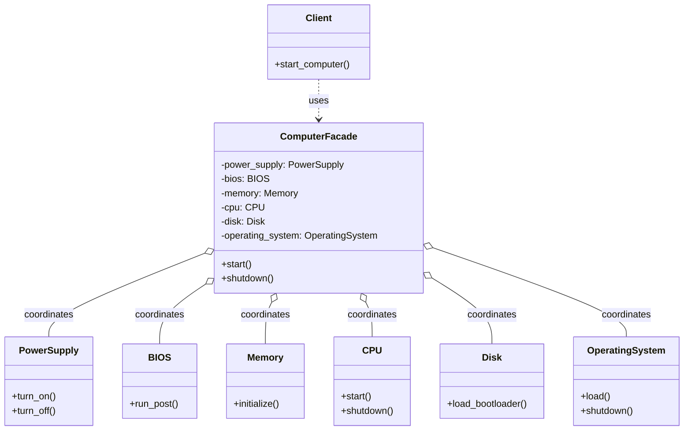

# Structural Pattern: Facade

## 1. Quick Summary

* **Intent:** Provide a simple, unified interface to a complex subsystem.
* **Core philosophy:** **Simplify access, not the subsystem.** The Facade coordinates several internal classes, while clients call only a small number of easy-to-understand methods.
* **Type:** Structural design pattern.
* **Analogy:** Pressing the power button on a computer. The user does not manually initialize the CPU, memory, BIOS, operating system, drivers, and applications. The power button offers one simple operation and hides the internal boot sequence.

### One-line interview definition

> Facade provides a simple interface over a group of complex classes, reducing the coupling between the client and the subsystem.

---

## 2. Why Do We Need the Facade Pattern?

### The problem: clients know too much

Imagine that a client wants to start a computer. Without a Facade, it may need to know the correct order of many operations:

```python
power_supply.turn_on()
bios.run_post()
memory.initialize()
cpu.start()
disk.load_bootloader()
operating_system.load()
drivers.load()
desktop.start()
```

This creates several problems:

* The client is tightly coupled to every subsystem class.
* The client must know the correct order of operations.
* A change inside the boot process forces changes in client code.
* The same orchestration logic may be duplicated by multiple clients.
* Invalid intermediate states become easier to create.

### The Facade solution

Create a `ComputerFacade` with one meaningful operation:

```python
computer.start()
```

The Facade internally coordinates all required components. The client depends on the Facade, not on every subsystem class.

**Important:** A Facade usually does not replace or remove the subsystem classes. They still exist and can remain available for advanced clients that need detailed control.

---

## 3. Real-Life Computer Bootup Example

When a person presses the power button:

1. The power supply provides stable power.
2. BIOS/UEFI performs a hardware self-test.
3. Memory is initialized.
4. The CPU begins execution.
5. The disk finds and loads the bootloader.
6. The operating system kernel is loaded.
7. Device drivers are initialized.
8. The desktop or login screen is shown.

The user sees one action: **turn on the computer**.

The power button is conceptually a Facade. It hides the complex subsystem interactions and gives the user a simple interface.

---

## 4. UML Class Diagram



### Roles in the pattern

| Participant | Responsibility |
| :--- | :--- |
| **Client** | Requests a high-level operation. It should not coordinate subsystem details. |
| **Facade** | Exposes a small, easy-to-use API and delegates work to the correct subsystem objects. |
| **Subsystem classes** | Perform the actual work. They do not need to know about the Facade. |

### Reading the UML diagram

* `Client` depends only on `ComputerFacade`.
* `ComputerFacade` contains references to the subsystem objects.
* The Facade calls the subsystem methods in the required order.
* The subsystem classes are independent of the client and Facade abstraction.

### Principle of Least Knowledge (Law of Demeter)

The **Principle of Least Knowledge** says:

> An object should know and talk to only a small number of closely related objects.

It is also called the **Law of Demeter**. The goal is to reduce coupling. When a class knows too many internal details of other objects, a small change in one part of the system can break many unrelated callers.

#### Simple example

This client knows too much about the computer's internal subsystem:

```python
computer.get_boot_manager().get_disk().get_bootloader().load()
```

This is often called a **train-wreck call** or **chained navigation**. The client depends on the exact internal object structure:

* `Computer` must expose `get_boot_manager()`.
* `BootManager` must expose `get_disk()`.
* `Disk` must expose `get_bootloader()`.
* `Bootloader` must expose `load()`.

If any internal relationship changes, the client must change too.

With a Facade, the client asks for the operation it actually needs:

```python
computer.start()
```

The client knows that a computer can start, but it does not need to know how the boot manager, disk, or bootloader are connected.

#### Python example: violating and following the principle

```python
class Screen:
    def show(self, message: str) -> None:
        print(message)


class Computer:
    def __init__(self) -> None:
        self._screen = Screen()

    def get_screen(self) -> Screen:
        return self._screen


# Too much knowledge: the caller navigates into Computer's internals.
computer = Computer()
computer.get_screen().show("Computer is ready")
```

A better design gives the owning class a meaningful operation:

```python
class Computer:
    def __init__(self) -> None:
        self._screen = Screen()

    def show_ready_message(self) -> None:
        self._screen.show("Computer is ready")


# The caller knows only the Computer operation it needs.
computer = Computer()
computer.show_ready_message()
```

In a real system, `ComputerFacade.start()` is an even stronger example: it hides the screen, operating system, disk, CPU, and power-supply details behind one workflow.

#### Practical rules

An object should generally call:

1. Its own methods.
2. Methods on objects passed as its parameters.
3. Methods on objects it creates.
4. Methods on its directly owned fields.
5. Methods on closely related objects, such as a parent object.

These are guidelines, not an absolute ban on every method chain. A chain such as `user.get_name().upper()` may be harmless when `get_name()` returns a value object or primitive. The concern is exposing and navigating a chain of collaborating objects.

#### Relationship between Facade and Least Knowledge

The Facade is a practical way to apply the Principle of Least Knowledge:

| Without a Facade | With a Facade |
| :--- | :--- |
| Client knows many subsystem classes | Client knows one high-level interface |
| Client controls call order | Facade controls the workflow |
| Internal object relationships leak outward | Internal relationships remain hidden |
| Changes ripple into many clients | Subsystem changes are isolated behind the Facade |

The principle does **not** mean that classes must know nothing. It means they should know only the collaborators necessary for their responsibility. Over-applying it can create many tiny forwarding methods, so use meaningful abstractions rather than blindly removing every method chain.

---

## 5. Python Code Implementation

```python
from __future__ import annotations


# ==========================================
# 1. SUBSYSTEM CLASSES
# ==========================================
class PowerSupply:
    def turn_on(self) -> None:
        print("Power supply: stable power provided")

    def turn_off(self) -> None:
        print("Power supply: power removed")


class BIOS:
    def run_post(self) -> None:
        print("BIOS: hardware self-test passed")


class Memory:
    def initialize(self) -> None:
        print("Memory: initialized")


class CPU:
    def start(self) -> None:
        print("CPU: started")

    def shutdown(self) -> None:
        print("CPU: stopped")


class Disk:
    def load_bootloader(self) -> None:
        print("Disk: bootloader loaded")


class OperatingSystem:
    def load(self) -> None:
        print("Operating system: kernel and drivers loaded")

    def shutdown(self) -> None:
        print("Operating system: shut down")


# ==========================================
# 2. FACADE
# ==========================================
class ComputerFacade:
    """Simple interface for the computer's boot and shutdown workflows."""

    def __init__(self) -> None:
        self._power_supply = PowerSupply()
        self._bios = BIOS()
        self._memory = Memory()
        self._cpu = CPU()
        self._disk = Disk()
        self._operating_system = OperatingSystem()

    def start(self) -> None:
        """Coordinate the complete boot sequence."""
        print("Starting computer...")
        self._power_supply.turn_on()
        self._bios.run_post()
        self._memory.initialize()
        self._cpu.start()
        self._disk.load_bootloader()
        self._operating_system.load()
        print("Computer is ready")

    def shutdown(self) -> None:
        """Coordinate the shutdown sequence in reverse order."""
        print("Shutting down computer...")
        self._operating_system.shutdown()
        self._cpu.shutdown()
        self._power_supply.turn_off()
        print("Computer is off")


# ==========================================
# 3. CLIENT
# ==========================================
if __name__ == "__main__":
    computer = ComputerFacade()

    # The client knows only two high-level operations.
    computer.start()
    computer.shutdown()
```

### Expected output

```text
Starting computer...
Power supply: stable power provided
BIOS: hardware self-test passed
Memory: initialized
CPU: started
Disk: bootloader loaded
Operating system: kernel and drivers loaded
Computer is ready
Shutting down computer...
Operating system: shut down
CPU: stopped
Power supply: power removed
Computer is off
```

### What the code demonstrates

* `ComputerFacade.start()` hides six subsystem calls and their ordering.
* The client does not create or coordinate `BIOS`, `CPU`, `Disk`, or other components.
* The same boot workflow can be reused by a command-line tool, GUI button, or test.
* Shutdown uses a separate high-level operation and hides its reverse-order details.

---

## 6. Facade Is Not the Same as a God Class

A Facade coordinates an existing subsystem; it should not contain all business logic.

### Healthy Facade

```python
class OrderFacade:
    def place_order(self, order_id: str) -> None:
        self._inventory.reserve(order_id)
        self._payment.charge(order_id)
        self._notification.send_confirmation(order_id)
```

The inventory, payment, and notification classes still own their own responsibilities.

### God class

A class that calculates inventory rules, processes card details, sends emails, writes SQL, and handles every error internally is not merely a Facade. It has too many responsibilities and violates the Single Responsibility Principle.

---

## 7. Facade vs. Similar Patterns

| Pattern | Main purpose | Difference from Facade |
| :--- | :--- | :--- |
| **Facade** | Simplify access to a complex subsystem | Usually changes the view of an existing subsystem, not its interface for compatibility |
| **Adapter** | Make incompatible interfaces work together | Translates one interface into another expected interface |
| **Mediator** | Centralize communication between peer objects | Subsystems communicate through the Mediator; a Facade mainly provides a high-level entry point |
| **Proxy** | Control access to one object | Adds access control, lazy loading, caching, or remote access |
| **Decorator** | Add behavior dynamically | Wraps an object to add responsibilities while preserving the same interface |

### Facade vs. Adapter: common interview trap

* Use **Facade** when the existing subsystem is usable but too complicated.
* Use **Adapter** when an existing class has the wrong interface.

Example:

* `computer.start()` hiding many boot steps: **Facade**.
* Converting `make_payment(amount_cents)` into the application's expected `pay(amount)`: **Adapter**.

---

## 8. Advantages

* **Reduces coupling:** Clients depend on one high-level class instead of many implementation classes.
* **Improves usability:** Common workflows become easy to discover and call.
* **Centralizes orchestration:** Ordering and coordination live in one place.
* **Protects clients from change:** Internal subsystem changes often do not affect callers.
* **Supports the Principle of Least Knowledge:** Clients talk to the small public surface they actually need.
* **Improves testability:** A client workflow can be tested through a small API.

---

## 9. Disadvantages and Pitfalls

* **Facade can become too large:** Adding every operation to one Facade creates a God class.
* **May hide useful control:** Advanced clients may need direct subsystem access.
* **Extra indirection:** Every high-level call adds another layer.
* **Not a security boundary by default:** A Facade simplifies access, but it does not automatically authorize or validate every operation.
* **Incorrect error handling can be dangerous:** The Facade should report failures clearly rather than silently pretending that the workflow succeeded.

### Good design practices

1. Keep Facade methods focused on meaningful workflows.
2. Let subsystem classes own subsystem-specific logic.
3. Expose advanced subsystem APIs only when there is a real use case.
4. Use explicit exceptions or result types when a workflow can fail.
5. Split unrelated workflows into multiple focused Facades.

---

## 10. When Should You Use Facade?

Use a Facade when:

* A subsystem has many classes or a complicated call sequence.
* Multiple clients repeat the same orchestration logic.
* You want application code to depend on a stable, high-level API.
* You are wrapping a legacy module, SDK, or infrastructure workflow.
* You want to separate application use cases from low-level implementation details.

Common software examples:

* `OrderFacade.place_order()` coordinating inventory, payment, and notifications.
* `FileUploadFacade.upload()` validating a file, storing a blob, saving metadata, and publishing an event.
* `HomeTheaterFacade.watch_movie()` coordinating lights, amplifier, projector, and player.
* A deployment service coordinating build, image push, migration, and rollout.
* A service-layer class coordinating repositories and external APIs for one use case.

Do not introduce a Facade just to wrap one trivial method or when it adds no meaningful simplification.

---

## 11. Interview-Ready Explanation

### 30-second answer

> Facade is a structural design pattern that provides a simple, high-level interface over a complex subsystem. For example, a `ComputerFacade.start()` method can coordinate the power supply, BIOS, memory, CPU, disk, and operating system in the correct order. The client calls one method and does not need to know the internal boot sequence. This reduces coupling and centralizes orchestration. A Facade simplifies a usable subsystem, whereas an Adapter translates an incompatible interface.

### Typical interview questions

#### 1. What problem does Facade solve?

It hides subsystem complexity and prevents clients from depending directly on many low-level classes and their ordering.

#### 2. Does Facade encapsulate all subsystem classes?

It encapsulates the common entry point, but the subsystem classes may still be accessible to advanced clients when direct control is required.

#### 3. Is Facade a wrapper?

Yes, in a broad sense, but its purpose is specifically to provide a simpler interface to a group of objects. An Adapter wraps one incompatible interface to make it compatible.

#### 4. Does Facade add business logic?

It can contain workflow orchestration, such as ordering calls and coordinating results. Detailed business rules should remain in the appropriate domain or subsystem classes.

#### 5. Can a system have multiple Facades?

Yes. Multiple focused Facades are usually better than one huge Facade, for example `CheckoutFacade`, `RefundFacade`, and `ReportingFacade`.

#### 6. Which SOLID principle does Facade support?

It commonly supports the **Dependency Inversion Principle** and **Principle of Least Knowledge** by allowing clients to depend on a small abstraction. A well-designed Facade also supports Single Responsibility by keeping orchestration separate from subsystem details.

#### 7. Is Facade compile-time or runtime?

It is a design-time structural organization, but the Facade object and its method calls operate at runtime.

#### 8. What is the main disadvantage?

The Facade can grow into a God class or hide too much control if every subsystem operation is added without considering client needs.

---

## 12. Quick Revision Checklist

Before an interview, remember:

* **Problem:** Complex subsystem and too much client coupling.
* **Solution:** One simple, high-level interface.
* **Example:** `ComputerFacade.start()`.
* **UML:** Client depends on Facade; Facade coordinates subsystem classes.
* **Key benefit:** Simpler client code and centralized workflow.
* **Key warning:** Do not turn the Facade into a God class.
* **Difference from Adapter:** Facade simplifies; Adapter translates.
* **Difference from Mediator:** Facade is an entry point; Mediator manages peer-to-peer communication.