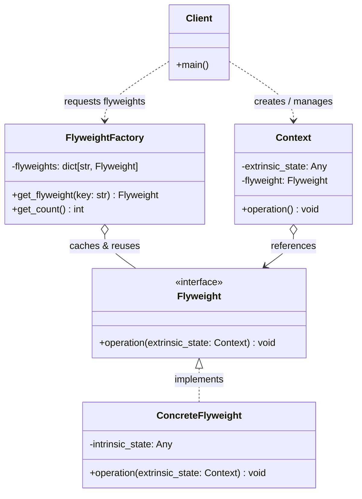
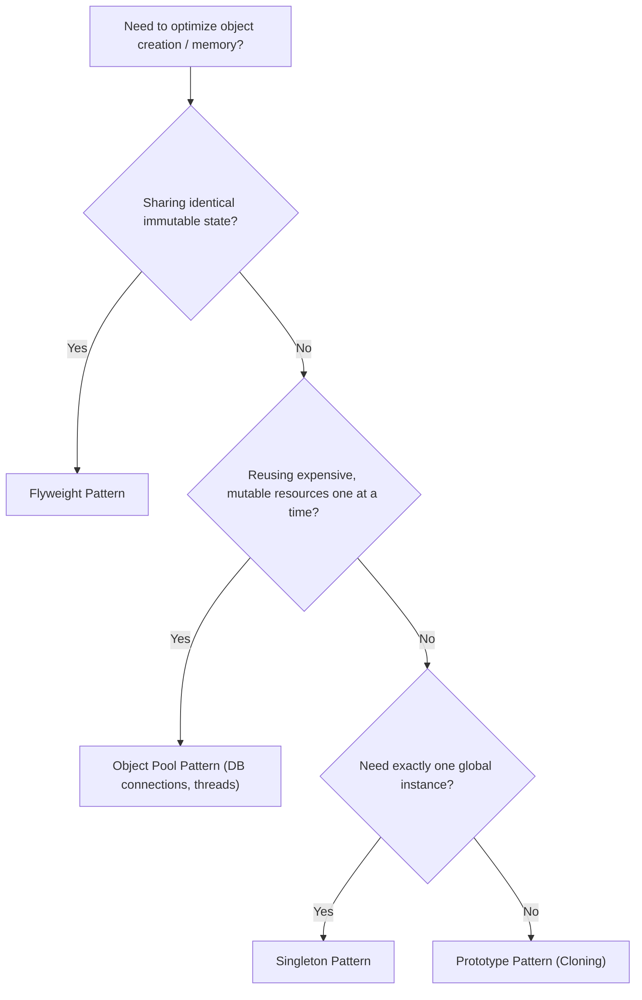

# Structural Pattern: Flyweight

## 1. Quick Summary

- **Intent:** Minimize memory usage and object-creation overhead by sharing common, immutable state among large numbers of fine-grained objects.
- **Core Philosophy:** **Don't store identical data a million times.** Split object state into **Intrinsic** (shared, immutable, context-free) and **Extrinsic** (unique, mutable, context-dependent). Store the intrinsic state once in shared Flyweight objects, and pass extrinsic state in when needed.
- **Type:** Structural design pattern.
- **Analogy:** Printing press movable type. Instead of hand-carving every single letter for every page of a 500-page book, a printing press casts metallic letter molds (flyweights) for 'A', 'B', 'C' once. The press reuses the single 'A' block across thousands of sentences, altering only its position (x, y coordinates on the paper) and ink color.

### One-Line Interview Definition

> The Flyweight pattern conserves memory by sharing invariant intrinsic state across multiple objects while delegating extrinsic state to the client context.

---

## 2. Why Do We Need the Flyweight Pattern?

### The Problem: Memory Explosion

Consider an open-world video game like _The Witcher_ or _Grand Theft Auto_ with a dense forest containing **1,000,000 trees**.

Each naive `Tree` object might store:

- `x: float`, `y: float`, `z: float` (Coordinates: 24 bytes)
- `height: float`, `width: float` (Dimensions: 16 bytes)
- `name: str` ("Oak Tree": ~50 bytes)
- `color: str` ("Forest Green": ~50 bytes)
- `mesh_data: bytes` (3D 3D polygonal geometry: ~20 KB)
- `texture_data: bytes` (High-res 2K leaf and bark texture: ~180 KB)

```text
Memory per Tree = ~200 KB
Total Memory for 1,000,000 Trees = 1,000,000 * 200 KB = ~200,000,000 KB ≈ 200 GB RAM!
```

A standard gaming PC or server will instantly crash with an **`OutOfMemory` (OOM)** error.

Yet, out of those 1,000,000 trees, there are really only 3 distinct visual types:

1. _Oak Tree_ (same mesh, same texture, same base color)
2. _Pine Tree_ (same mesh, same texture, same base color)
3. _Birch Tree_ (same mesh, same texture, same base color)

Storing identical 200 KB texture/mesh data 1,000,000 times is 99.99% pure redundancy.

### The Flyweight Solution

Extract the heavy, repeated data into a single shared object called a **Flyweight** (`TreeType`):

- **Intrinsic State (Inside `TreeType`):** `name`, `color`, `mesh_data`, `texture_data` (Stored only **3 times** in memory = ~600 KB total).
- **Extrinsic State (Inside lightweight `Tree` context):** `x`, `y`, `z`, `height`, `width` + a pointer/reference to the shared `TreeType` (~32 bytes per tree = ~32 MB for 1,000,000 trees).

```text
Total Memory with Flyweight:
3 TreeType Flyweights (~600 KB) + 1,000,000 Contexts (~32 MB) ≈ ~32.6 MB RAM (vs 200 GB!)
Over 99.98% memory reduction!
```

---

## 3. Real-World Applications

1. **Word Processors & Text Editors (e.g., Microsoft Word, Google Docs, VS Code):**
   - A 100,000-word document contains over 500,000 characters.
   - If each character was an object with its own font family, glyph bitmap, kerning tables, font size, and color, RAM would spike into gigabytes.
   - **Flyweight Solution:** The glyph representation of character `'e'` in Arial 12pt is loaded once. The character instances only store their line/column positions.
2. **Web Browsers (DOM Render Trees):**
   - Repeated CSS computed styles (e.g., standard button styling, paragraph text style) are shared among thousands of DOM nodes rather than duplicated per element.
3. **Gaming & Particle Engines:**
   - Thousands of bullets, raindrops, smoke particles, or sparks sharing identical particle sprites and physics properties while varying only in position and velocity vectors.
4. **Map Rendering (Google Maps / Apple Maps):**
   - Rendering millions of road markers, tree icons, building sprites, and metro station icons across the world map.

---

## 4. Deep Dive: Intrinsic vs. Extrinsic State

The entire Flyweight pattern hinges on properly separating these two categories of state. This is the **#1 question asked in LLD interviews** regarding Flyweight.

| Characteristic            | Intrinsic State                                    | Extrinsic State                                              |
| :------------------------ | :------------------------------------------------- | :----------------------------------------------------------- |
| **Definition**            | Invariant, context-independent data                | Variant, context-dependent data                              |
| **Where it lives**        | Stored **inside** the Flyweight object             | Stored in the **Context** object or calculated by the Client |
| **Mutability**            | **Strictly Immutable** (Read-only)                 | Mutable or unique per instance                               |
| **Shareability**          | Shared across thousands of contexts                | Never shared; unique to each context                         |
| **Lifecycle**             | Created once (usually cached in a factory)         | Created per occurrence                                       |
| **Example (Forest)**      | 3D mesh, foliage texture, species name             | `(x, y, z)` coordinates, age, wind sway                      |
| **Example (Text Editor)** | Font family, glyph curve vector, unicode codepoint | Screen coordinates `(line, col)`, cursor selection           |
| **Example (Coffee Shop)** | Coffee flavor, roast profile, brewing recipe       | Table number, customer name, sugar spoons                    |

> [!IMPORTANT]
> **Immutability is mandatory for Intrinsic State:** Because a Flyweight is shared among hundreds or millions of contexts, mutating its intrinsic state would instantly corrupt every single context that points to it.

---

## 5. UML Class Diagram



### Roles and Responsibilities

| Role                      | Responsibility                                                                                                                                  |
| :------------------------ | :---------------------------------------------------------------------------------------------------------------------------------------------- |
| **Flyweight (Interface)** | Declares the method through which concrete flyweights receive and act on extrinsic state.                                                       |
| **ConcreteFlyweight**     | Stores intrinsic state. Must be immutable and independent of the context in which it is used.                                                   |
| **FlyweightFactory**      | Creates and manages flyweights. Maintains a pool/dictionary. When requested, returns an existing flyweight or creates a new one if not present. |
| **Context**               | Holds the extrinsic state and a reference to the corresponding Flyweight. Couples unique context data with the shared flyweight.                |
| **Client**                | Calculates or stores extrinsic state and coordinates the creation of contexts via the factory.                                                  |

---

## 6. Code Examples: Without vs. With Flyweight Pattern

Let's build a realistic simulation: **A Game Forest with 100,000 Trees**.

### Scenario A: WITHOUT Flyweight (The Naive Approach)

In this approach, every single tree object holds its own copy of the mesh and texture data.

```python
"""
naive_forest.py - WITHOUT Flyweight Pattern
Every tree allocates its own copy of heavy mesh/texture data.
"""
from __future__ import annotations
import sys
import tracemalloc


class NaiveTree:
    def __init__(
        self,
        x: float,
        y: float,
        name: str,
        color: str,
        mesh_data: bytes,
        texture_data: bytes,
    ) -> None:
        # Extrinsic state
        self.x = x
        self.y = y

        # Intrinsic state duplicated in every single instance!
        self.name = name
        self.color = color
        self.mesh_data = mesh_data
        self.texture_data = texture_data

    def render(self) -> None:
        # Emulate drawing
        pass


def run_naive_simulation(num_trees: int = 100_000) -> None:
    tracemalloc.start()

    # Heavy asset simulation (e.g., 5 KB mesh + 25 KB texture = 30 KB per tree)
    sample_mesh = b"X" * (5 * 1024)
    sample_texture = b"T" * (25 * 1024)

    forest: list[NaiveTree] = []
    tree_types = [
        ("Oak", "Dark Green"),
        ("Pine", "Emerald"),
        ("Birch", "Light Yellow"),
    ]

    for i in range(num_trees):
        name, color = tree_types[i % 3]
        tree = NaiveTree(
            x=float(i % 1000),
            y=float(i // 1000),
            name=name,
            color=color,
            # Duplicating 30 KB strings across 100,000 objects!
            mesh_data=sample_mesh,
            texture_data=sample_texture,
        )
        forest.append(tree)

    current, peak = tracemalloc.get_traced_memory()
    tracemalloc.stop()

    print("--- WITHOUT Flyweight ---")
    print(f"Total trees created: {len(forest):,}")
    print(f"Current Memory: {current / (1024 * 1024):.2f} MB")
    print(f"Peak Memory:    {peak / (1024 * 1024):.2f} MB")


if __name__ == "__main__":
    run_naive_simulation(50_000)
```

**Result:**

- Peak Memory: **~1,470 MB (1.47 GB)** for just 50,000 trees. At 1,000,000 trees, Python would consume **~30 GB RAM** or crash.

---

### Scenario B: WITH Flyweight Pattern (The Production-Ready Approach)

We separate:

1. `TreeType` (Flyweight): Holds invariant `name`, `color`, `mesh_data`, `texture_data`.
2. `TreeFactory` (Flyweight Factory): Maintains an internal dictionary cache of `TreeType` objects.
3. `Tree` (Context): Holds coordinates `x`, `y` and a reference to the shared `TreeType`.

```python
"""
flyweight_forest.py - WITH Flyweight Pattern
Shared intrinsic state via TreeType + TreeFactory.
"""
from __future__ import annotations
import tracemalloc
from typing import Dict, Tuple


# =====================================================================
# 1. THE FLYWEIGHT (Stores Intrinsic State)
# =====================================================================
class TreeType:
    """
    Concrete Flyweight: Shared, immutable state.
    Contains heavy 3D mesh and texture data.
    """
    __slots__ = ("_name", "_color", "_mesh_data", "_texture_data")

    def __init__(
        self,
        name: str,
        color: str,
        mesh_data: bytes,
        texture_data: bytes,
    ) -> None:
        self._name = name
        self._color = color
        self._mesh_data = mesh_data
        self._texture_data = texture_data

    @property
    def name(self) -> str:
        return self._name

    @property
    def color(self) -> str:
        return self._color

    def draw(self, x: float, y: float) -> None:
        """
        Extrinsic state (x, y) is passed in as arguments.
        The flyweight uses its intrinsic state alongside the passed extrinsic state.
        """
        # In a real graphics engine, you would bind self._texture_data and draw at (x, y)
        pass


# =====================================================================
# 2. THE FLYWEIGHT FACTORY (Manages & Reuses Flyweights)
# =====================================================================
class TreeFactory:
    """
    Flyweight Factory: Ensures flyweights are shared properly.
    Creates new flyweights only when they do not already exist.
    """
    _tree_types: Dict[Tuple[str, str], TreeType] = {}

    @classmethod
    def get_tree_type(
        cls,
        name: str,
        color: str,
        mesh_data: bytes,
        texture_data: bytes,
    ) -> TreeType:
        key = (name, color)
        if key not in cls._tree_types:
            print(f"[Factory] Creating NEW TreeType Flyweight for {key}...")
            cls._tree_types[key] = TreeType(name, color, mesh_data, texture_data)
        return cls._tree_types[key]

    @classmethod
    def total_flyweights_created(cls) -> int:
        return len(cls._tree_types)


# =====================================================================
# 3. THE CONTEXT (Stores Extrinsic State + Reference to Flyweight)
# =====================================================================
class Tree:
    """
    Context Object: Lightweight.
    Contains unique extrinsic state (x, y) and references the shared TreeType.
    """
    __slots__ = ("x", "y", "tree_type")

    def __init__(self, x: float, y: float, tree_type: TreeType) -> None:
        self.x = x
        self.y = y
        self.tree_type = tree_type

    def draw(self) -> None:
        # Delegate drawing to the shared flyweight, passing extrinsic coordinates
        self.tree_type.draw(self.x, self.y)


# =====================================================================
# 4. CLIENT / SIMULATION
# =====================================================================
class Forest:
    def __init__(self) -> None:
        self.trees: list[Tree] = []

    def plant_tree(
        self,
        x: float,
        y: float,
        name: str,
        color: str,
        mesh_data: bytes,
        texture_data: bytes,
    ) -> None:
        # Get shared flyweight from factory
        tree_type = TreeFactory.get_tree_type(name, color, mesh_data, texture_data)
        # Create lightweight context
        tree = Tree(x, y, tree_type)
        self.trees.append(tree)

    def draw(self) -> None:
        for tree in self.trees:
            tree.draw()


def run_flyweight_simulation(num_trees: int = 100_000) -> None:
    tracemalloc.start()

    # Heavy asset simulation (30 KB per asset type)
    sample_mesh = b"X" * (5 * 1024)
    sample_texture = b"T" * (25 * 1024)

    forest = Forest()
    tree_specs = [
        ("Oak", "Dark Green"),
        ("Pine", "Emerald"),
        ("Birch", "Light Yellow"),
    ]

    for i in range(num_trees):
        name, color = tree_specs[i % 3]
        forest.plant_tree(
            x=float(i % 1000),
            y=float(i // 1000),
            name=name,
            color=color,
            mesh_data=sample_mesh,
            texture_data=sample_texture,
        )

    current, peak = tracemalloc.get_traced_memory()
    tracemalloc.stop()

    print("\n--- WITH Flyweight Pattern ---")
    print(f"Total trees planted:          {len(forest.trees):,}")
    print(f"Total Flyweights in Factory:  {TreeFactory.total_flyweights_created()}")
    print(f"Current Memory:               {current / (1024 * 1024):.2f} MB")
    print(f"Peak Memory:                  {peak / (1024 * 1024):.2f} MB")


if __name__ == "__main__":
    run_flyweight_simulation(50_000)
```

### Side-by-Side Benchmark Comparison (50,000 Objects)

| Metric                   | Without Flyweight               | With Flyweight                   | Improvement                  |
| :----------------------- | :------------------------------ | :------------------------------- | :--------------------------- |
| **Heavy Objects in RAM** | 50,000 distinct asset copies    | **3 shared instances**           | **99.99% fewer assets**      |
| **Peak RAM Usage**       | **~1,470 MB (1.47 GB)**         | **~5.1 MB**                      | **~99.65% Memory Reduction** |
| **OOM Risk at Scale**    | Guaranteed crash at ~200k items | Easily handles 10,000,000+ items | Production Grade             |

---

## 7. Python-Specific Optimizations: Flyweight & `__slots__`

In Python, standard class instances store their attributes in a dynamic dictionary (`__dict__`). This adds ~150–200 bytes of overhead per empty instance.

When combined with Flyweight, using **`__slots__`** eliminates the per-instance `__dict__` and `__weakref__`, drastically optimizing memory:

```python
class LightweightContext:
    # Pre-allocates fixed C-level array of pointers instead of a dynamic dict
    __slots__ = ("x", "y", "flyweight_ref")

    def __init__(self, x: float, y: float, flyweight_ref: TreeType) -> None:
        self.x = x
        self.y = y
        self.flyweight_ref = flyweight_ref
```

### Python's Built-in Flyweights (Language Internals)

Python itself applies the Flyweight pattern under the hood:

1. **Small Integer Caching:**
   CPython pre-allocates and shares integer objects in the range `[-5, 256]`:

   ```python
   a = 100
   b = 100
   print(a is b)  # True! Same object in memory (Flyweight)

   x = 1000
   y = 1000
   print(x is y)  # False (outside pre-allocated range)
   ```

2. **String Interning (`sys.intern`):**
   Python automatically interns identifier-like strings (variable names, dictionary keys). You can also explicitly intern strings to share memory:

   ```python
   import sys
   s1 = sys.intern("very_long_repeated_category_string_from_database")
   s2 = sys.intern("very_long_repeated_category_string_from_database")
   print(s1 is s2)  # True! Stored only once in memory
   ```

3. **Singletons like `None`, `True`, `False`:**
   Every reference to `None` in Python points to the exact same shared sentinel object.

---

## 8. Flyweight vs. Similar Patterns (Interview Pitfalls)

Interviewers frequently ask candidates to distinguish Flyweight from other creational or structural patterns:



### 1. Flyweight vs. Object Pool (Crucial Interview Trap)

- **Flyweight:**
  - Multiple clients use the **same shared object simultaneously** (read-only / immutable).
  - Focuses on saving **memory** when millions of objects coexist.
  - _Example:_ 1,000,000 trees sharing 3 `TreeType` objects at the same time.
- **Object Pool:**
  - An object is checked out, used by **one client exclusively**, mutated, and checked back in.
  - Focuses on saving **CPU/allocation time** for expensive-to-create resources.
  - _Example:_ Database connection pool, thread pool, socket pool.

### 2. Flyweight vs. Singleton

- **Singleton:** Enforces that a class has **only one** instance throughout the entire application lifecycle.
- **Flyweight:** Can have **multiple** instances (e.g., Oak, Pine, Birch in `TreeType`), each representing a unique immutable intrinsic state. Flyweights are contextual and typically created via a factory.

### 3. Flyweight vs. Prototype

- **Prototype:** Clones a base object to produce **new, independent, mutable** copies.
- **Flyweight:** Avoids creating new copies altogether by **sharing references** to the original immutable instance.

### 4. Flyweight vs. Composite

- Flyweight is often combined with **Composite** to implement shared leaf nodes in a tree structure (e.g., shared character glyphs forming words and paragraphs).

---

## 9. Advantages & Disadvantages

### Advantages

- **Massive Memory Reduction:** Decreases RAM consumption proportionally to the number of duplicate attributes.
- **Fewer Heavy Allocations:** Cuts down GC pressure and OS memory allocations for heavy resources (textures, meshes, fonts).
- **Improved Cache Locality:** When thousands of contexts refer to a few hot Flyweight instances, CPU L1/L2 cache hits increase significantly during rendering/processing loops.

### Disadvantages & Trade-offs

- **CPU vs. Memory Trade-off:** Calling methods on Flyweights requires passing extrinsic state into every call, slightly increasing stack frame overhead and runtime calculations.
- **Code Complexity:** Splitting a clean domain entity (e.g., `Tree`) into two separate entities (`TreeType` and `Tree`) and introducing a `Factory` increases architectural complexity.
- **Risk of State Leakage / Thread Safety:** If a developer accidentally adds mutable state into a Flyweight, changes made by one thread or context will invisibly corrupt all other contexts.

---

## 10. When Should You Use Flyweight?

Apply the Flyweight pattern only when **all** of the following conditions are met:

1. The application spawns a **massive number** of objects (tens of thousands to millions).
2. Memory consumption is a **primary bottleneck** (or approaching OOM limits).
3. Most of the object's state can be made **extrinsic and separated** from intrinsic state.
4. Many objects can be replaced by a **few shared objects** once extrinsic state is extracted.
5. The application **does not depend on object identity** (`tree1 is tree2` cannot be relied upon for contexts).

> [!WARNING]
> Do **not** use Flyweight prematurely if you only have a few dozen or hundred objects. The added indirection and code complexity will not justify the negligible memory savings.

---

## 11. Complete Interview Ready Q&A (Top 8 Questions)

### Q1: What is the core intent of the Flyweight pattern?

> **Answer:** To drastically reduce memory usage when creating huge quantities of similar objects by sharing common immutable data (intrinsic state) rather than duplicating it across each instance.

### Q2: What is the difference between Intrinsic and Extrinsic state?

> **Answer:**
>
> - **Intrinsic State:** Invariant, context-independent, and immutable. It is stored inside the Flyweight and shared (e.g., font glyph, 3D mesh).
> - **Extrinsic State:** Variant and context-dependent. It is stored outside the Flyweight (inside the Context object or passed by the caller) and is unique to each occurrence (e.g., coordinates, line/column number).

### Q3: Why MUST Intrinsic state be immutable?

> **Answer:** Because a Flyweight object is shared simultaneously across potentially thousands of callers. If one caller could mutate the intrinsic state, that modification would immediately and unpredictably alter the state for all other contexts sharing that instance.

### Q4: How does Flyweight differ from an Object Pool?

> **Answer:**
> In a **Flyweight**, the same object is shared simultaneously by multiple callers in a read-only manner to save memory.
> In an **Object Pool**, objects are checked out for exclusive use by one caller at a time, modified, and returned when done, primarily saving creation/destruction time (e.g., DB connections).

### Q5: Can a Flyweight have mutable extrinsic state?

> **Answer:** The _Flyweight itself_ cannot store mutable state. However, the _Context object_ that references the Flyweight can freely store and mutate extrinsic state, or pass mutable state into the Flyweight's methods as parameters.

### Q6: Where and how does Python utilize the Flyweight concept internally?

> **Answer:**
>
> 1. Small integer caching (integers from `-5` to `256` are pre-allocated singletons).
> 2. String interning via `sys.intern()`.
> 3. Global constants like `None`, `True`, `False`.
> 4. `__slots__` attribute optimization to strip per-instance dictionary overhead.

### Q7: What role does the Factory play in the Flyweight pattern?

> **Answer:** The Flyweight Factory acts as a cache manager. Clients never instantiate Flyweights directly; they request one from the factory by passing key parameters. The factory checks its lookup cache: returning an existing instance if available, or creating and caching a new one if not.

### Q8: What are the main trade-offs of using Flyweight?

> **Answer:** The main trade-off is **memory savings vs. code complexity and CPU overhead**. You trade simpler, self-contained objects for separated Context + Flyweight classes and a Factory. Passing extrinsic state into methods can also introduce minor CPU and function call overhead.

---

## 12. Quick Revision Checklist

Before an interview, keep these bullet points in your head:

- [ ] **Problem:** High object count $\rightarrow$ RAM exhaustion due to duplicate invariant data.
- [ ] **Solution:** Extract invariant data into shared `Flyweight`s; keep unique data in `Context`s.
- [ ] **Two States:**
  - **Intrinsic:** Shared, immutable, inside Flyweight.
  - **Extrinsic:** Unique, contextual, outside Flyweight.
- [ ] **Components:** `FlyweightInterface`, `ConcreteFlyweight`, `FlyweightFactory` (lookup cache), `Context` (holds extrinsic state + flyweight ref).
- [ ] **Comparison:** Flyweight = shared simultaneously (RAM saving); Object Pool = checked out exclusively (CPU/time saving).
- [ ] **Python Trick:** Use `__slots__` on Context and Flyweight classes to eliminate `__dict__` overhead.
- [ ] **Analogy:** Printing press movable type blocks (molds created once, positions vary on paper).

