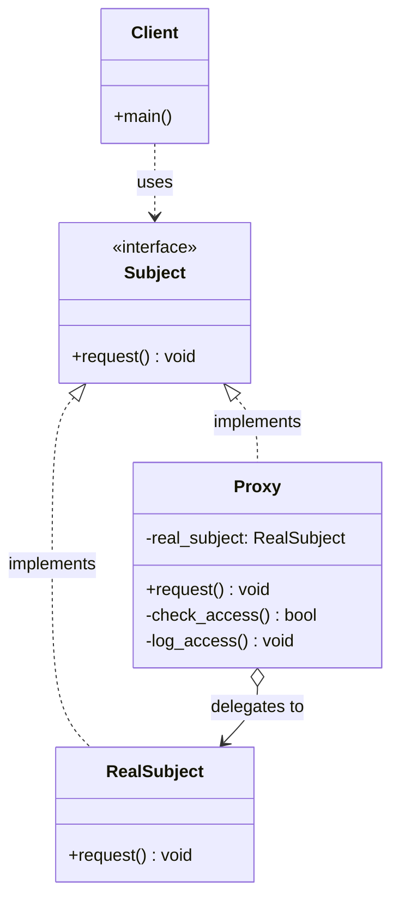
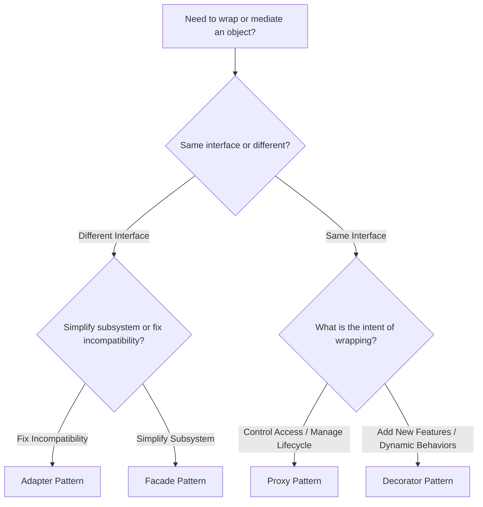

# Structural Pattern: Proxy

## 1. Quick Summary

* **Intent:** Provide a surrogate, placeholder, or intermediary for another object to control, mediate, or optimize access to it.
* **Core Philosophy:** **Control access without changing the interface.** The client interacts with the Proxy believing it is talking directly to the Real Subject because both implement the exact same interface.
* **Type:** Structural design pattern.
* **Analogy:** **Debit / Credit Card.** A credit card is a proxy for the cash sitting in your bank account. You swipe the card instead of carrying stacks of paper money. The card checks your PIN, validates your credit limit, records transaction logs, and delegates the final debiting to the bank.

### One-Line Interview Definition

> A Proxy provides a surrogate or placeholder for another object to control and manage access to it while maintaining an identical interface.

---

## 2. Why Do We Need the Proxy Pattern?

### The Problem: Uncontrolled & Expensive Direct Access

In software systems, directly accessing or instantiating a target object can introduce severe issues:

1. **Heavy Resource Initialization:** Instantiating an object that loads a 2 GB 3D CAD model or connects to a high-latency remote database at startup slows down the entire application, even if the user never accesses that feature.
2. **Security & Access Control:** Giving clients raw access to a database or sensitive service bypasses authentication, rate limiting, and role-based permissions (RBAC).
3. **Redundant Expensive Calls:** Repeatedly querying an external microservice or running heavy computations wastes CPU and network bandwidth when results could be cached.
4. **Scattered Cross-Cutting Concerns:** Mixing logging, caching, authentication, and error retries directly inside the core business class violates the **Single Responsibility Principle (SRP)**.

### The Proxy Solution

Insert a **Proxy** class between the Client and the Real Subject:

```
[ Client ]  --->  [ Proxy (Checks Auth, Caches, Lazy Loads) ]  --->  [ Real Subject ]
```

Because the Proxy implements the **same interface** as the Real Subject:
* The client does not know (and does not care) that it is communicating with a proxy.
* The Real Subject remains focused purely on its core business logic.
* Access control, caching, lazy loading, and logging are centralized in the proxy layer.

---

## 3. Major Types of Proxies (Interview Essentials)

Interviewers frequently ask candidates to identify or design specific proxy types. Here are the 5 core variants:

| Proxy Type | Core Purpose | Real-World Scenario |
| :--- | :--- | :--- |
| **1. Virtual Proxy** | **Lazy Initialization:** Defers creating expensive resources until explicitly invoked. | Loading a high-res 4K image or video stream only when scrolled into view. |
| **2. Protection Proxy** | **Access Control:** Verifies credentials, user roles, and permissions before forwarding requests. | Enforcing RBAC (e.g., only `ADMIN` can execute `delete_record()`). |
| **3. Caching Proxy** | **Performance Optimization:** Stores results of expensive operations and serves repeated queries from memory. | Caching HTTP/database queries locally to avoid roundtrips. |
| **4. Remote Proxy** | **Network Abstraction:** Represents an object that exists in a different address space or server. | RPC clients, gRPC stubs, Pyro4 in Python, REST client SDKs. |
| **5. Smart Reference / Logging Proxy** | **Housekeeping & Metrics:** Counts active references, logs method calls, measures execution latency. | Reference counting, telemetry decorators, distributed tracing. |

---

## 4. UML Class Diagram



### Roles and Responsibilities

| Role | Responsibility |
| :--- | :--- |
| **Subject (Interface)** | Declares the common interface for both `RealSubject` and `Proxy`. Enables the client to treat the proxy transparently. |
| **RealSubject** | Contains the core business logic. Performs the actual heavy or sensitive work. |
| **Proxy** | Implements `Subject`. Holds a reference to `RealSubject`. Controls lifecycle (creation/deletion), access checks, caching, or logging before/after delegating to `RealSubject`. |
| **Client** | Works with any object implementing `Subject` without caring whether it is the real service or a proxy. |

---

## 5. Python Code Implementation

### Example 1: Protection & Caching Proxy (Document Vault System)

A production-grade example demonstrating:
1. **Protection Proxy:** Verifies user roles (`ADMIN`, `USER`, `GUEST`).
2. **Caching Proxy:** Caches downloaded documents in memory to eliminate redundant disk/network I/O.
3. **Audit Logging:** Logs all access attempts with timestamps.

```python
"""
document_proxy.py - Production-ready Protection & Caching Proxy
"""
from __future__ import annotations
from abc import ABC, abstractmethod
from typing import Dict, Optional
import time


# =====================================================================
# 1. SUBJECT INTERFACE
# =====================================================================
class DocumentService(ABC):
    """Common interface implemented by both RealSubject and Proxy."""

    @abstractmethod
    def get_document(self, doc_id: str, user_role: str) -> str:
        """Fetch content of a document."""
        pass


# =====================================================================
# 2. REAL SUBJECT (Core Business Logic)
# =====================================================================
class RealDocumentService(DocumentService):
    """
    Heavy/Sensitive service. Simulates database or cloud storage reads.
    Contains only core business logic; no caching or auth logic.
    """

    def __init__(self) -> None:
        print("[RealDocumentService] Initializing database connections...")
        # Simulate heavy storage initialization
        self._storage = {
            "doc-101": "Confidential Q3 Financial Report: Revenue = $12M",
            "doc-102": "Engineering Roadmap: Microservices Migration plan",
            "doc-103": "Public Company Holiday Calendar 2026",
        }

    def get_document(self, doc_id: str, user_role: str) -> str:
        # Simulate network or disk latency
        print(f"[RealDocumentService] Fetching '{doc_id}' from disk/cloud storage...")
        time.sleep(0.5)

        if doc_id in self._storage:
            return self._storage[doc_id]
        raise ValueError(f"Document with ID '{doc_id}' not found.")


# =====================================================================
# 3. PROXY (Controls Access, Adds Caching & Audit Logging)
# =====================================================================
class DocumentServiceProxy(DocumentService):
    """
    Combines Protection Proxy and Caching Proxy.
    Intercepts calls, checks RBAC, serves from cache, and logs access.
    """

    def __init__(self) -> None:
        # Virtual Proxy behavior: RealDocumentService is instantiated lazily
        self._real_service: Optional[RealDocumentService] = None
        self._cache: Dict[str, str] = {}

    def _get_real_service(self) -> RealDocumentService:
        """Lazy initialization of the expensive real service."""
        if self._real_service is None:
            self._real_service = RealDocumentService()
        return self._real_service

    def _check_permission(self, doc_id: str, user_role: str) -> bool:
        """Protection Proxy logic: Role-based access control."""
        restricted_docs = {"doc-101", "doc-102"}
        if doc_id in restricted_docs and user_role not in ("ADMIN", "MANAGER"):
            return False
        return True

    def get_document(self, doc_id: str, user_role: str) -> str:
        # 1. Protection Check (Security)
        if not self._check_permission(doc_id, user_role):
            print(f"[Proxy - DENIED] Access denied for doc '{doc_id}' by role '{user_role}'.")
            raise PermissionError(f"Role '{user_role}' is not authorized to view document '{doc_id}'.")

        # 2. Caching Check (Optimization)
        if doc_id in self._cache:
            print(f"[Proxy - CACHE HIT] Returning '{doc_id}' directly from memory cache.")
            return self._cache[doc_id]

        # 3. Delegate to Real Subject
        print(f"[Proxy - CACHE MISS] Delegating request for '{doc_id}' to RealDocumentService.")
        real_service = self._get_real_service()
        content = real_service.get_document(doc_id, user_role)

        # 4. Update Cache
        self._cache[doc_id] = content
        return content


# =====================================================================
# 4. CLIENT CODE
# =====================================================================
def run_client() -> None:
    # Client depends on DocumentService interface, instantiated with Proxy
    service: DocumentService = DocumentServiceProxy()

    print("\n--- Request 1: GUEST views public document ---")
    doc = service.get_document("doc-103", user_role="GUEST")
    print(f"Content: {doc}")

    print("\n--- Request 2: Repeated request for same document (Cache Hit) ---")
    start = time.time()
    doc_cached = service.get_document("doc-103", user_role="GUEST")
    print(f"Content: {doc_cached} (Elapsed: {time.time() - start:.4f}s)")

    print("\n--- Request 3: GUEST attempts to view confidential financial report ---")
    try:
        service.get_document("doc-101", user_role="GUEST")
    except PermissionError as err:
        print(f"Caught expected error: {err}")

    print("\n--- Request 4: ADMIN views confidential financial report ---")
    doc_admin = service.get_document("doc-101", user_role="ADMIN")
    print(f"Content: {doc_admin}")


if __name__ == "__main__":
    run_client()
```

---

### Example 2: Virtual Proxy (Lazy Loading Heavy Image)

A classic Virtual Proxy example: deferring expensive disk/network loading until `display()` is called.

```python
"""
virtual_image_proxy.py - Virtual Proxy for Lazy Loading
"""
from abc import ABC, abstractmethod
from typing import Optional


class Graphic(ABC):
    @abstractmethod
    def display(self) -> None:
        pass


class HighResolutionImage(Graphic):
    """Expensive object that loads an 80MB image file into RAM."""

    def __init__(self, filename: str) -> None:
        self.filename = filename
        self._load_from_disk()

    def _load_from_disk(self) -> None:
        print(f"  [Disk I/O] Loading high-resolution image '{self.filename}' into memory (~80 MB)...")

    def display(self) -> None:
        print(f"  [Screen] Rendering image '{self.filename}' on canvas.")


class ImageProxy(Graphic):
    """
    Virtual Proxy: Holds filename and dimension metadata.
    Does NOT load the image until display() is called.
    """

    def __init__(self, filename: str) -> None:
        self.filename = filename
        self._real_image: Optional[HighResolutionImage] = None

    def display(self) -> None:
        # Load only on first display call
        if self._real_image is None:
            self._real_image = HighResolutionImage(self.filename)
        self._real_image.display()


# --- Demonstration ---
if __name__ == "__main__":
    print("Step 1: Instantiating ImageProxy for 3 images...")
    # Zero disk I/O, instant startup!
    images: list[Graphic] = [
        ImageProxy("photo_gallery_01.raw"),
        ImageProxy("photo_gallery_02.raw"),
        ImageProxy("photo_gallery_03.raw"),
    ]
    print("Done! Application started instantly without memory spikes.\n")

    print("Step 2: User scrolls and views image 1:")
    images[0].display()

    print("\nStep 3: User views image 1 again (already loaded):")
    images[0].display()
```

---

## 6. Proxy vs. Similar Patterns (The Ultimate Interview Comparison)

Candidates frequently confuse **Proxy**, **Decorator**, **Adapter**, and **Facade**. Interviewers test this aggressively.



### Detailed Pattern Comparison Matrix

| Feature | Proxy | Decorator | Adapter | Facade |
| :--- | :--- | :--- | :--- | :--- |
| **Interface** | **Identical** to Real Subject | **Identical** to Component | **Different** (adapted to target) | **New, simpler** interface |
| **Primary Intent** | **Control access**, lifecycle, or optimize | **Add responsibilities / behaviors** dynamically | **Translate** incompatible interfaces | **Simplify** a complex subsystem |
| **Subject Lifecycle** | Proxy usually manages or creates Real Subject | Decorator receives component via constructor | Adapter wraps an existing instance | Facade creates/coordinates multiple instances |
| **Client Awareness** | Client thinks it uses Real Subject | Client enhances functionality via chaining | Client targets the desired interface | Client uses high-level facade API |
| **Classic Example** | Lazy loading images, RBAC auth check | Adding border/scroll to Window, gzip compression | Converting XML to JSON, European plug to US socket | `Computer.start()` booting CPU, RAM, Disk |

### Proxy vs. Decorator: The Critical Interview Distinction

* **Both** implement the exact same interface as the wrapped object.
* **The Difference is Intent:**
  * **Decorator** never restricts access or prevents calls. Its sole job is to layer on *additional behaviors* (e.g., `coffee -> with_milk -> with_sugar`).
  * **Proxy** controls, filters, or delays access. It can reject a call (Protection Proxy), intercept with a cached value (Caching Proxy), or postpone creation (Virtual Proxy).

---

## 7. Python-Specific Implementations of Proxy

Python provides dynamic metaprogramming features that make implementing proxies elegant without manually forwarding every method:

### 1. Dynamic Attribute Delegation with `__getattr__`

```python
class LoggingProxy:
    """Wraps any arbitrary object and logs method invocations automatically."""

    def __init__(self, target: object) -> None:
        self._target = target

    def __getattr__(self, name: str):
        attr = getattr(self._target, name)
        if callable(attr):
            def wrapper(*args, **kwargs):
                print(f"[Audit Log] Calling method '{name}' with args={args}, kwargs={kwargs}")
                start_time = time.perf_counter()
                result = attr(*args, **kwargs)
                elapsed = time.perf_counter() - start_time
                print(f"[Audit Log] Method '{name}' completed in {elapsed:.6f}s")
                return result
            return wrapper
        return attr
```

### 2. Built-in Python Proxies

1. **`functools.lru_cache`:** Acts as a Caching Proxy wrapping standard functions.
2. **`weakref.proxy`:** Creates a weak reference proxy to an object without increasing its reference count.
3. **`unittest.mock.MagicMock` / `Mock`:** Acts as a dynamic test proxy intercepting and asserting calls.

---

## 8. Advantages and Disadvantages

### Advantages

* **Separation of Concerns (SRP):** Keeps authorization, lazy loading, and caching logic out of core business classes.
* **Open/Closed Principle (OCP):** Introduce new proxies (logging, caching, telemetry) without modifying `RealSubject` or `Client`.
* **Resource Optimization:** Virtual proxies prevent massive initial memory footprint and speed up system startup.
* **Security & Encapsulation:** Protection proxies ensure unauthorized clients cannot trigger sensitive actions.
* **Location Transparency:** Remote proxies hide network protocols, serialization, and connection handling from callers.

### Disadvantages & Pitfalls

* **Added Indirection:** Every call traverses another layer, adding minor call stack overhead.
* **Potential Latency:** In remote or protection proxies, network failures or authorization checks can delay responses.
* **Maintenance Complexity:** If the `Subject` interface changes, both `RealSubject` and all `Proxy` implementations must be updated.

---

## 9. When Should You Use Proxy?

Use Proxy when you need to:

- [x] **Delay object creation** until it is actually used (**Virtual Proxy**).
- [x] **Enforce permissions** based on user identity or roles (**Protection Proxy**).
- [x] **Cache responses** from an expensive service or database (**Caching Proxy**).
- [x] **Interact with remote services** without leaking networking logic (**Remote Proxy**).
- [x] **Audit, trace, or count references** to an object transparently (**Smart Reference Proxy**).

---

## 10. Complete Interview Ready Q&A (Top 8 Questions)

### Q1: What is the primary purpose of the Proxy pattern?
> **Answer:** To provide a surrogate or placeholder object that controls, mediates, or optimizes access to another real object while exposing the identical interface to the client.

### Q2: What is the key difference between Proxy and Decorator?
> **Answer:** Both implement the exact same interface as the wrapped object, but their intent is different:
> * **Decorator** enhances or adds new behavior to an object without restricting access.
> * **Proxy** manages lifecycle, restricts/validates access, or optimizes performance (caching/lazy loading), and can block calls entirely.

### Q3: What is a Virtual Proxy? Give a real-world example.
> **Answer:** A Virtual Proxy defers the creation and loading of an expensive resource until the moment a client actually calls its methods.
> *Example:* In a document viewer or web page, image placeholders are created instantly; the high-resolution 50MB bitmap is only downloaded and allocated in RAM when that image scrolls into the active viewport.

### Q4: How does a Protection Proxy work?
> **Answer:** A Protection Proxy verifies authentication and permissions (such as RBAC) before forwarding a request to the real subject. If the caller lacks sufficient privileges, the proxy throws an exception or rejects the call without touching the underlying service.

### Q5: How does the Proxy pattern adhere to SOLID principles?
> **Answer:**
> * **Single Responsibility Principle (SRP):** The real service focuses exclusively on business logic, while the proxy handles cross-cutting concerns (auth, caching, logging).
> * **Open/Closed Principle (OCP):** New proxies can be introduced (e.g., adding rate limiting or telemetry) without modifying the real service or client code.

### Q6: Can a Proxy manage the lifecycle of the Real Subject?
> **Answer:** Yes. In many implementations (particularly Virtual and Remote Proxies), the proxy is responsible for instantiating, initializing, and releasing the Real Subject. In Protection or Decorator-like proxies, the Real Subject may be passed in via dependency injection.

### Q7: How does Proxy differ from Facade?
> **Answer:**
> * A **Proxy** wraps a **single** object and exposes the **exact same interface**.
> * A **Facade** wraps an entire **subsystem of multiple objects** and exposes a **new, simplified interface**.

### Q8: What is a Remote Proxy, and how does it relate to RPC/gRPC?
> **Answer:** A Remote Proxy is a local object that represents an entity living on a remote server or in another process. When a local method is invoked on the proxy, it handles serialization, socket communication, error retries, and deserialization, making the remote call feel like an in-memory method call. gRPC stubs are classic Remote Proxies.

---

## 11. Quick Revision Checklist

Before stepping into an interview:

- [ ] **Definition:** Intermediary object controlling access to a Real Subject under the **same interface**.
- [ ] **Core Analogy:** Credit/Debit card controlling access to a bank account.
- [ ] **5 Core Types:**
  1. **Virtual** (Lazy initialization)
  2. **Protection** (Auth & RBAC)
  3. **Caching** (Result storage)
  4. **Remote** (RPC / network abstraction)
  5. **Smart Reference** (Logging / reference counting)
- [ ] **Proxy vs. Decorator Trap:** Proxy controls access/lifecycle; Decorator adds new features.
- [ ] **Proxy vs. Facade Trap:** Proxy = 1 object, same interface; Facade = subsystem, simpler new interface.
- [ ] **Python implementation:** Subclassing `ABC` or using dynamic delegation via `__getattr__`.
